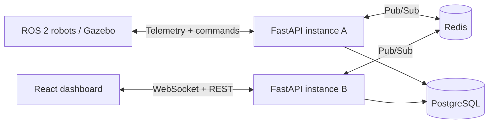

# Robot Fleet Telemetry & Control

Cloud-connected robot fleet monitoring and control with ROS 2 telemetry, a real-time dashboard, and persistent fleet data.

## Demo


[Watch the original project demo](https://samsonajadalu.com/projects/metal-to-cloud-telemetry/) · [Command and control](docs/images/03-interactive-command-control.png) · [Stored fleet](docs/images/02-stored-fleet-persistence.png)

## Features

- **Live monitoring:** Robot position, velocity, battery level, and status streamed to the dashboard over WebSockets.
- **Remote control:** Dashboard commands routed through FastAPI to individual ROS 2 robots.
- **Fleet simulation:** Multiple TurtleBot3 robots with Gazebo and Nav2 integration.
- **Persistent telemetry:** Robot and session data stored in PostgreSQL.
- **Distributed messaging:** Redis Pub/Sub relays messages across FastAPI instances so robots and dashboards can connect to different API instances.

## Architecture



Robots publish telemetry through their ROS 2 bridges. The API persists fleet data and routes dashboard commands back to the selected robot. Redis provides inter-instance delivery when WebSocket connections are spread across API replicas.

## Tech stack

| Area | Technologies |
| --- | --- |
| Robotics | ROS 2 Humble, TurtleBot3, Gazebo, Nav2, Python |
| Backend | FastAPI, WebSockets, SQLAlchemy |
| Frontend | React, TypeScript |
| Data | PostgreSQL |
| Messaging | Redis Pub/Sub |
| Deployment | Docker Compose, AWS ECS Fargate, ElastiCache, RDS, S3, CloudFront |

## Getting started

```bash
git clone https://github.com/SamsonAjadalu/robot-fleet-telemetry-control.git
cd robot-fleet-telemetry-control
```

Start the local stack with `docker compose up -d --build`, or deploy to AWS, then connect the robot fleet:

- **[Local setup](docs/deployment/local.md):** Run PostgreSQL, Redis, two FastAPI instances, and React with Docker Compose.
- **[AWS deployment](docs/deployment/aws.md):** Run the backend on ECS Fargate with RDS and ElastiCache, and serve the dashboard from S3 through CloudFront.
- **[ROS 2 robot setup](docs/robot-setup.md):** Install the robot dependencies, build the ROS 2 bridge, and launch the Gazebo fleet against the local or cloud API.

Open the dashboard to monitor telemetry, send commands, and inspect stored fleet data.

## Acknowledgments

This project builds upon [Metal-to-Cloud Telemetry](https://github.com/SamsonAjadalu/metal-to-cloud-telemetry), originally developed as a team project at the University of Toronto.

## License

[MIT License](LICENSE)
