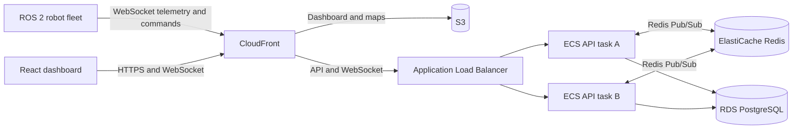
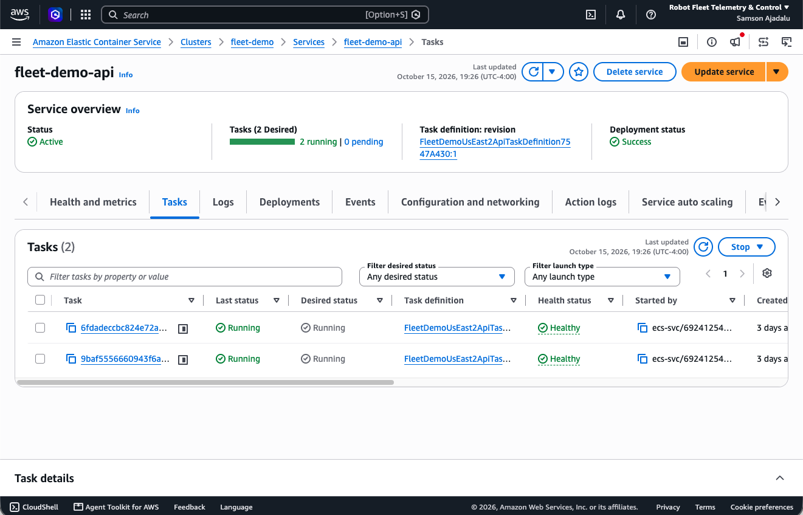
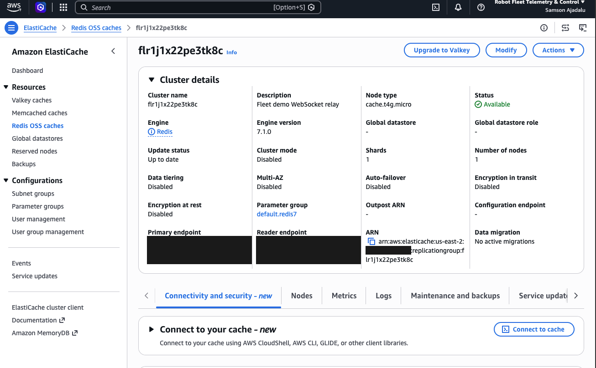
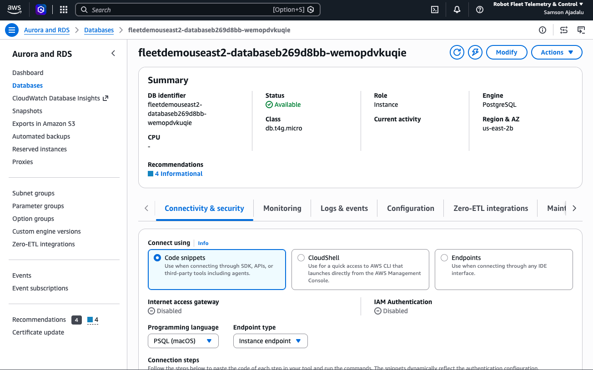

# AWS Deployment

Deploy Robot Fleet Telemetry & Control with ECS Fargate, ElastiCache Redis, RDS PostgreSQL, Amazon S3, CloudFront, and an Application Load Balancer.

## Architecture



CloudFront serves HTTPS and WSS traffic. The frontend and map assets are stored in S3. ECR stores the FastAPI container image. Both ECS tasks use the same Redis Pub/Sub channel to route WebSocket telemetry and commands across instances.

## Configuration

| Component | Value |
| --- | --- |
| CDK stack | `FleetDemoUsEast2` |
| Default region | `us-east-2` |
| ECS | `fleet-demo` cluster · `fleet-demo-api` service · 2 Fargate tasks |
| API image | `fleet-demo-backend` ECR repository, port `8000` |
| PostgreSQL | RDS PostgreSQL 15, `robot_fleet` database |
| Redis | ElastiCache Redis 7.1, `robot-fleet:websocket` Pub/Sub channel |
| Frontend and maps | Private S3 bucket with CloudFront |
| Logs | CloudWatch `/fleet-demo/api` |

The CDK source is in [`infra/`](../../infra/). It configures `DB_HOST` from RDS, loads `DB_PASSWORD` through Secrets Manager, builds `REDIS_URL` from the ElastiCache endpoint, and sets `REDIS_REQUIRED=true`. The frontend build sets `VITE_API_BASE_URL` to the CloudFront HTTPS origin. The API and dashboard share the CloudFront origin.

## Deploy

From the repository root, install AWS CLI, Docker, Node.js, and the AWS CDK dependencies. Configure AWS credentials with permission to create the stack resources.

### 1. Provision infrastructure

```bash
export AWS_REGION=us-east-2
export AWS_DEFAULT_REGION="$AWS_REGION"
ACCOUNT_ID=$(aws sts get-caller-identity --query Account --output text)

npm --prefix infra install
(cd infra && npx cdk bootstrap "aws://$ACCOUNT_ID/$AWS_REGION")

(cd infra && npx cdk deploy FleetDemoUsEast2 \
  --context runService=false --require-approval never)
```

This creates the VPC, ECR repository, ECS resources, Redis, RDS, ALB, S3, CloudFront, and logs. The API service starts with zero tasks until the backend image is published.

### 2. Publish the backend image

```bash
stack_output() {
  aws cloudformation describe-stacks --stack-name FleetDemoUsEast2 \
    --query "Stacks[0].Outputs[?OutputKey=='$1'].OutputValue | [0]" \
    --output text
}

ECR_URI=$(stack_output EcrRepositoryUri)
ECR_REGISTRY="${ECR_URI%%/*}"

docker build --platform linux/amd64 -t "$ECR_URI:latest" -f backend/Dockerfile backend
aws ecr get-login-password --region "$AWS_REGION" | \
  docker login --username AWS --password-stdin "$ECR_REGISTRY"
docker push "$ECR_URI:latest"
```

### 3. Publish the dashboard and maps

The example map is in `frontend/public/maps/map_01/`. Each robot map uses `<map_id>.png` and `<map_id>.yaml` inside its corresponding directory. Vite includes these files in `frontend/dist/maps/`, and the S3 sync publishes them alongside the dashboard. CloudFront serves `/maps/*` from the frontend S3 origin.

```bash
CF_DOMAIN=$(stack_output CloudFrontDomainName)
BUCKET=$(stack_output FrontendBucketName)
DIST_ID=$(stack_output CloudFrontDistributionId)

npm --prefix frontend ci
VITE_API_BASE_URL="https://$CF_DOMAIN" npm --prefix frontend run build
aws s3 sync frontend/dist "s3://$BUCKET" --delete
aws cloudfront create-invalidation --distribution-id "$DIST_ID" --paths '/*'
```

### 4. Start the API service

```bash
(cd infra && npx cdk deploy FleetDemoUsEast2 \
  --context runService=true --require-approval never)

aws ecs wait services-stable --cluster fleet-demo --services fleet-demo-api
```

## Verify

```bash
curl -fsS "https://$CF_DOMAIN/health"
curl -fsS "https://$CF_DOMAIN/ready"

aws ecs describe-services --cluster fleet-demo --services fleet-demo-api \
  --query 'services[0].{desired:desiredCount,running:runningCount}'

aws logs tail /fleet-demo/api --since 30m
```

`/ready` checks the required Redis relay. ECS should report two running tasks. Open `https://$CF_DOMAIN` for the dashboard and `https://$CF_DOMAIN/maps/map_01/map_01.yaml` to check the sample map.

**Connect the robots:** Follow the [ROS 2 robot setup](../robot-setup.md) with `wss://<your-cloudfront-domain>` as the backend URL.

## Deployment screenshots

### ECS tasks



### ElastiCache Redis



### RDS PostgreSQL


